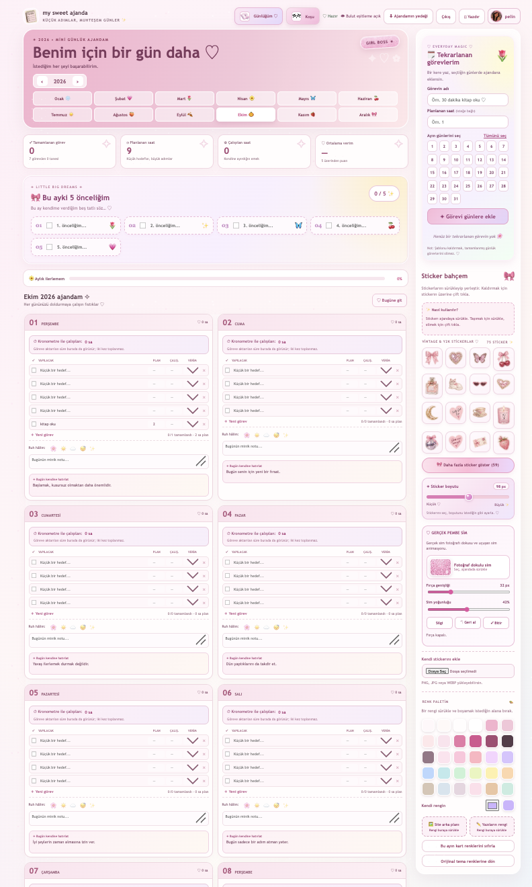
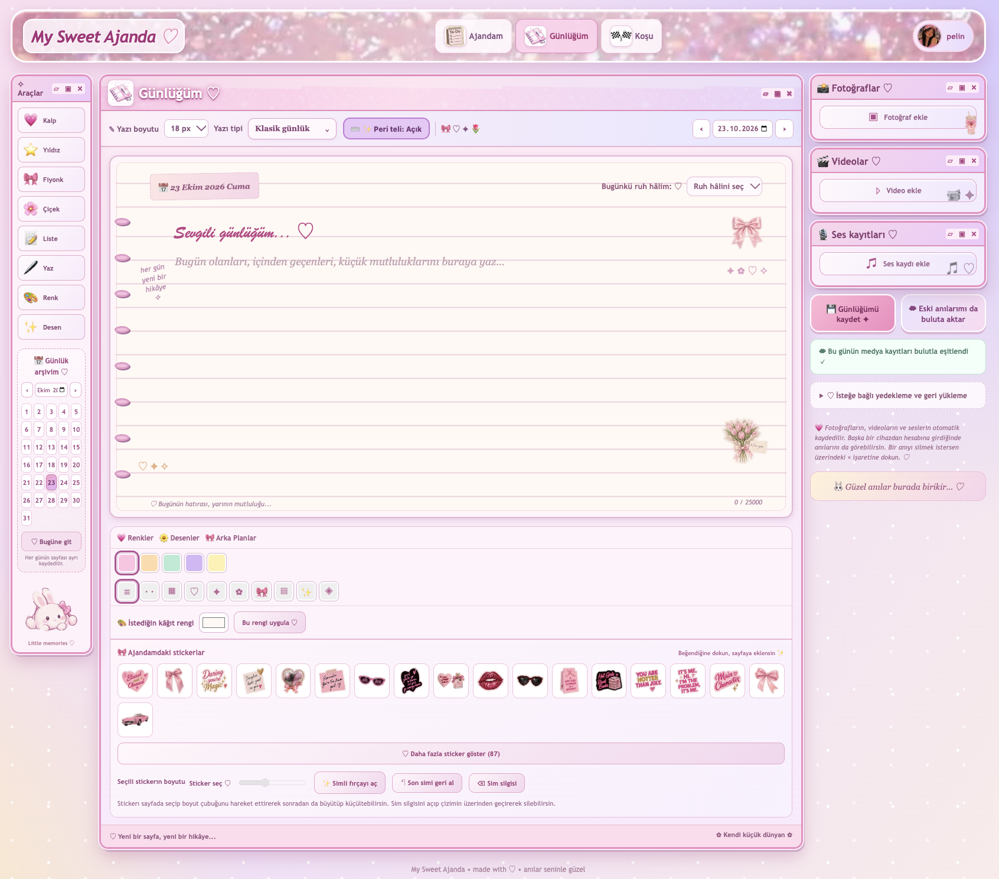
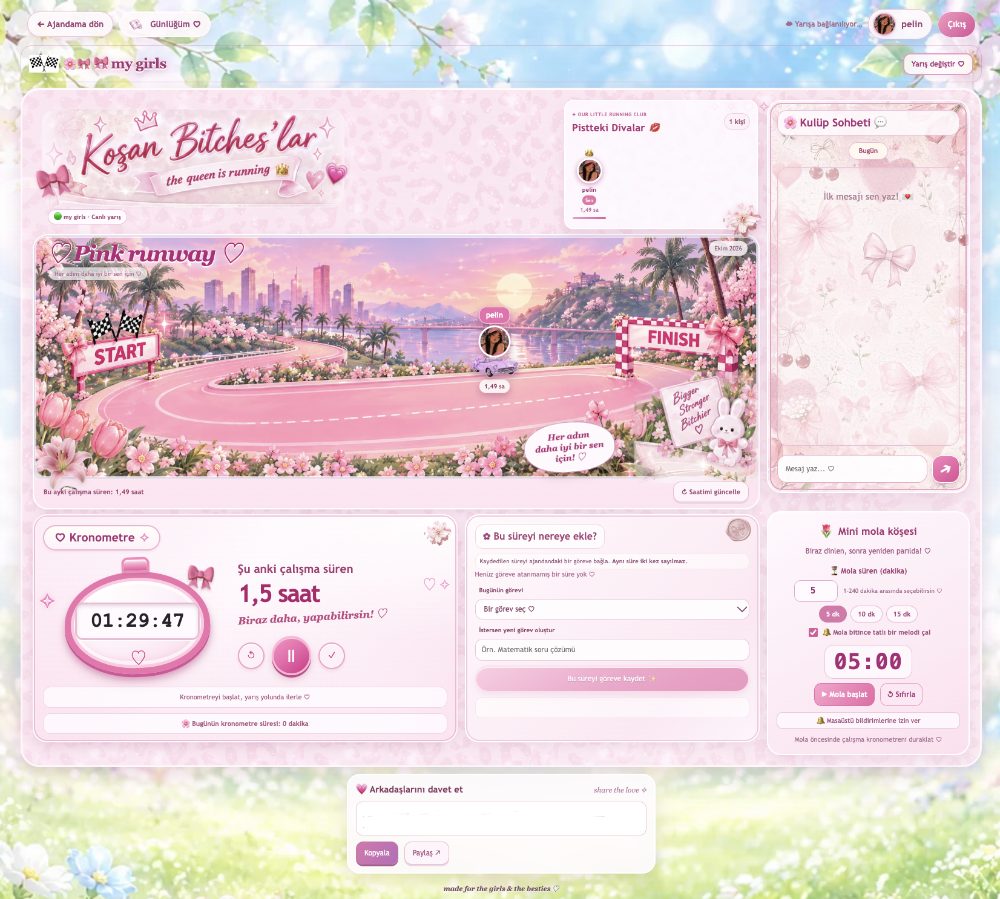

<p align="center">
  
</p>

<h1 align="center">My Sweet Ajanda 🎀</h1>

<p align="center">
  A pastel-inspired productivity web app combining a personal planner, a digital journal, and real-time study races.
</p>

<p align="center">
  <a href="https://kingp4-cmyk.github.io/my-sweet-planner/"><strong>Live website</strong></a>
</p>

## Overview

My Sweet Ajanda is a personal web development project designed to make everyday planning and focused study more enjoyable. It brings individual organization and shared study sessions together in one browser-based experience, with a customizable pink/Y2K interface.

The interface is in Turkish. An account and email verification are required to use the cloud-connected features.

## Screenshots

### Planner
<p align="center">
  
</p>

### Journal
<p align="center">
  
</p>

### Real-time Study Race
<p align="center">
  
</p>

## Features

### Planner
- Plan daily tasks in a calendar-based interface.
- Customize pages with colors, stickers, avatars, and uploaded sticker images.
- Track study time and connect recorded sessions with individual days.
- Keep planner data in local browser storage and synchronize it with Firestore for signed-in users.

### Personal journal
- Write date-based entries and browse previous days through an archive calendar.
- Personalize entries with themes, decorative elements, and drawings.
- Attach supported photos, videos, and audio recordings.
- Store journal entries in Firestore and use IndexedDB plus Supabase-backed media synchronization for attachments.
- Export and import journal backups.

### Real-time study club
- Create study rooms and join others using invitation links or room codes.
- Follow participant activity, accumulated study time, and a shared chat.
- Receive room and message updates in real time through Firestore listeners.
- Use study timers, optional break reminders, and sound effects.

### Accounts and interface
- Sign up, sign in, reset passwords, and verify email addresses with Firebase Authentication.
- Use a responsive interface with a playful pastel visual style.

## Tech stack

| Layer | Technologies |
| --- | --- |
| Front end | HTML5, CSS3, JavaScript (ES modules) |
| Authentication | Firebase Authentication |
| Application data and real-time updates | Cloud Firestore |
| Journal media | IndexedDB, Supabase Storage, Supabase Edge Function |
| Client-side persistence | localStorage, IndexedDB |
| Hosting | GitHub Pages |

The application uses native browser APIs and loads Firebase modules from the official CDN. It does not require a front-end build tool.

## How it works

- **Planner:** Local browser state supports immediate interaction, while authenticated data is synchronized with Firestore.
- **Journal:** Text entries and metadata are handled separately from larger media files. Attachments use local browser storage and a server-mediated Supabase media flow.
- **Study club:** Room information, participants, and chat messages are updated with Firestore subscriptions rather than manual refreshes.

This separation keeps the planner, journal, and study club as distinct parts of the application while sharing account management.

## Run locally

You can serve the front end with a simple local HTTP server:

```bash
# From the project directory
python3 -m http.server 8000
```

Open **http://127.0.0.1:8000/** in your browser. Python 3 is required for this command.

> **Backend setup:** The checked-in Firebase web configuration points to the existing project. For a separate deployment, supply your own Firebase configuration, appropriate Firestore Security Rules, and compatible Supabase services. Cloud features depend on those services; copying the static files alone does not create an independent backend. Never place service-role or other server secrets in client-side files.

## Project structure

```text
my-sweet-ajanda/
├── index.html               # Planner and entry page
├── journal.html             # Journal interface
├── race.html                # Study club interface
├── app.js                   # Authentication and planner synchronization
├── script.js                # Planner behavior
├── journal.js               # Journal data and interface
├── journal-media-cloud.js   # Journal media synchronization
├── club.js                  # Study rooms and real-time chat
├── race-timer.js            # Study timer and session handling
├── cozy-features.js         # Breaks and interface sounds
├── assets/                  # Images, avatars, stickers, and illustrations
└── *.css                    # Styles for each section
```

## Development notes

Some of the more challenging parts of this project are handling synchronization between browser storage and cloud data, keeping media uploads separate from journal text, and reflecting study-room activity in real time. The project has evolved through multiple iterations, including mobile layout adjustments and performance improvements.

## Current scope

This is a student portfolio project and is still being improved. It has not been presented as a security-audited or production-scale service. Access to personal data ultimately depends on the deployed backend's security rules and permissions.

---

Built and maintained by [Pelin Özdemir](https://github.com/kingp4-cmyk).
